# 🛒 Ceylon Foods — Sri Lanka Online Supermarket & Operations Platform

An AI-powered, omnichannel supermarket platform tailored for Sri Lankan customers, built with React, Vite, TypeScript, Tailwind CSS, Express, and modern monorepo workspaces.

Featuring the **Ceylon Foods** cultural design system, authentic Sri Lankan rupee (`Rs.` / `LKR`) grocery pricing, iconic local FMCG brands (Dilmah, Highland, Munchee, Maliban, MD, Bairaha, Araliya), and full Colombo & Greater Suburbs delivery logistics alongside a secure 12-module operations management portal.

---

## 📸 Screenshots & Visual Previews (Captured from Live System)

### 🛒 1. Customer Supermarket Storefront (Light Theme — Authentic Ceylon Foods Home Page)


### ✨ 2. Cultural Splash Screen (˗ˏˋ ආයුබෝවන්.! ˎˊ˗ — Sigiriya & Island Harvest Vista)


### 🌙 3. Customer OLED Dark Mode


### 🛍️ 4. Customer Cart Drawer — Promo Code Engine & Colombo Delivery Zones
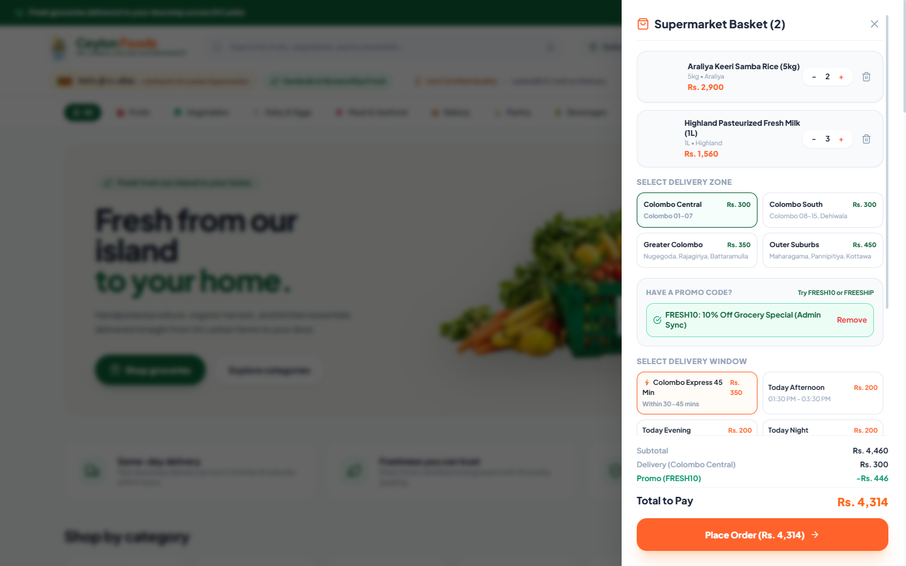

### 🔐 5. Ceylon Foods Operations Authentication Portal


### 📈 6. Ceylon Foods Operations Dashboard (Sales LKR 8.46M, Donut Order Health & Trends)
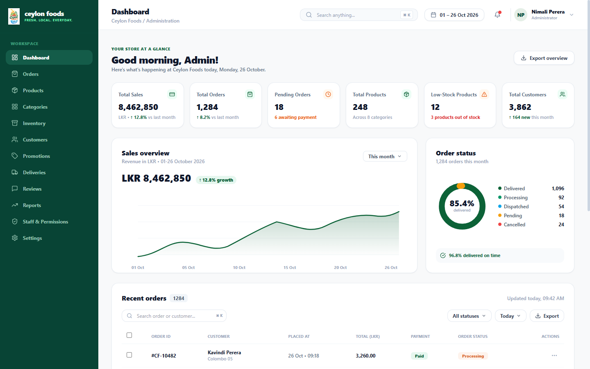

### 📋 7. Order Management & Fulfillment Register (All Orders, Processing, Dispatched)


### 🏷️ 8. Products Catalog Management (Availability Statuses, Pricing, Categories)
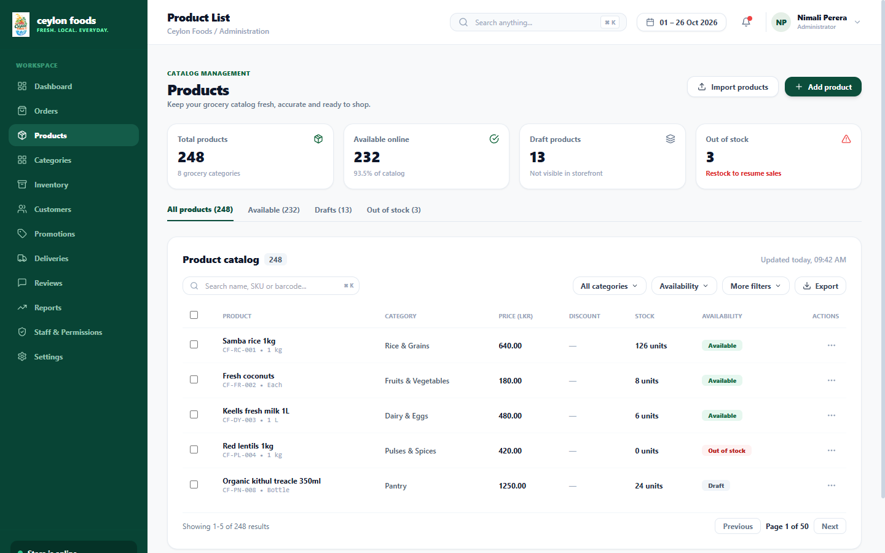

### 🗂️ 9. Catalog Organisation & Visual Categories (Photographic Aisles & Display Orders)


### 📦 10. Stock Control & Inventory Management (Tracked, In Stock, Low Stock, Shortage Alerts)
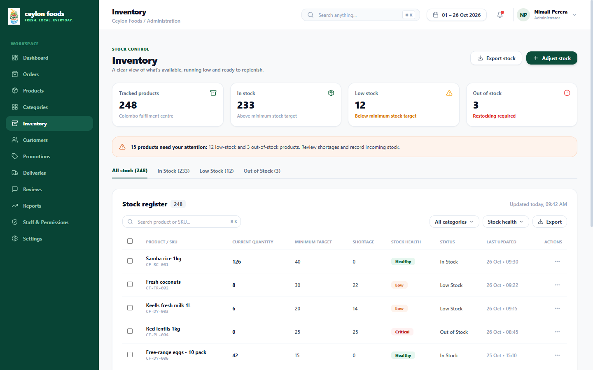

### 🚚 11. Last-Mile Deliveries & Courier Operations (Awaiting Assignment, On Road, Delivered Today)
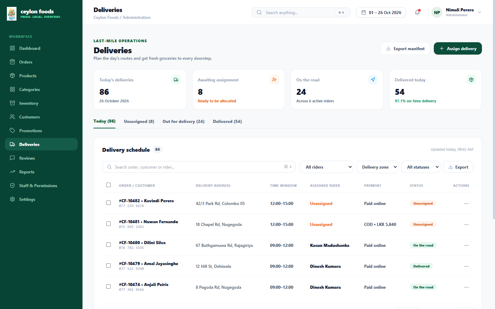

### 🎟️ 12. Promotions & Campaign Vouchers (Active Codes, Redemption Limits, Rule Toggles)
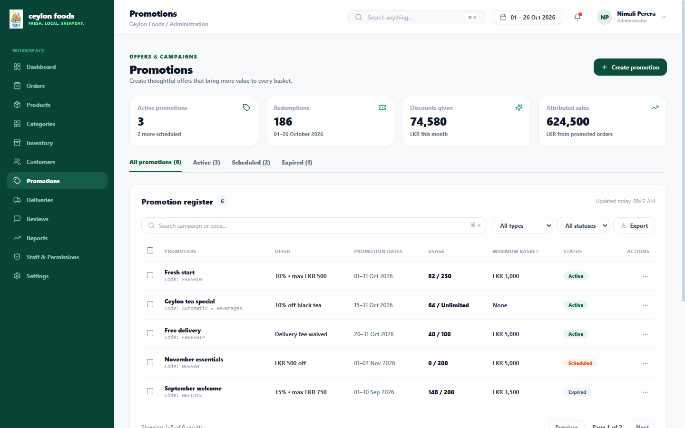

### 📊 13. Business Intelligence & Revenue Insights (Net Sales LKR 8.46M, AOV LKR 6,591, Returning 64.2%)
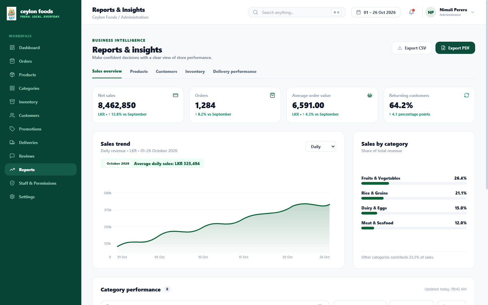

### 👥 14. Staff Management & Role-Based Access Control (2FA Enforcement, Capability Matrix)
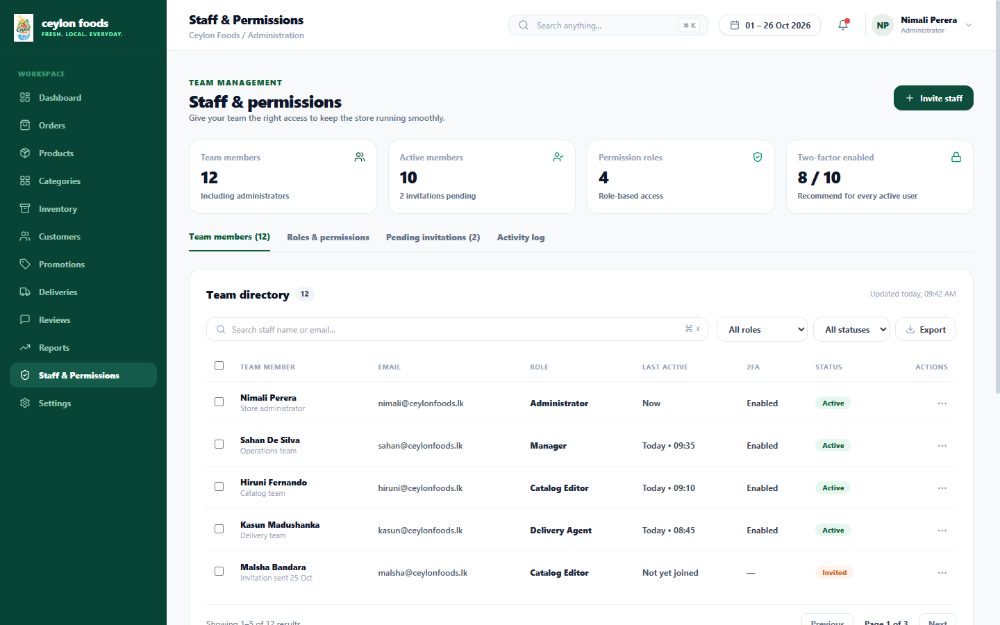

### ⚙️ 15. Store Settings & Regional Configuration (LKR Currency, PayHere, VAT, Delivery Zones)
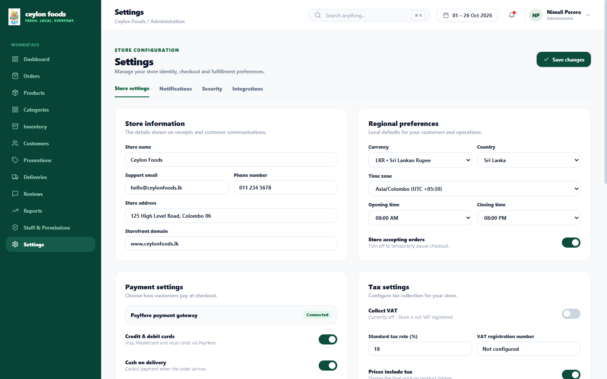

### ⭐ 16. Customer Reviews & Sentiment Cockpit (4.9 Rating, Verified Purchases, Moderation)
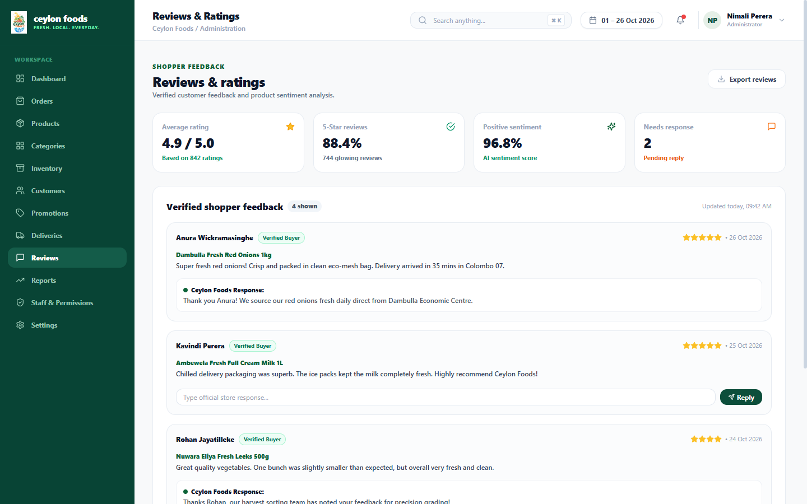

### 🤝 17. Customer Accounts & Loyalty Tier Directory (Platinum, Gold, Silver, Bronze)
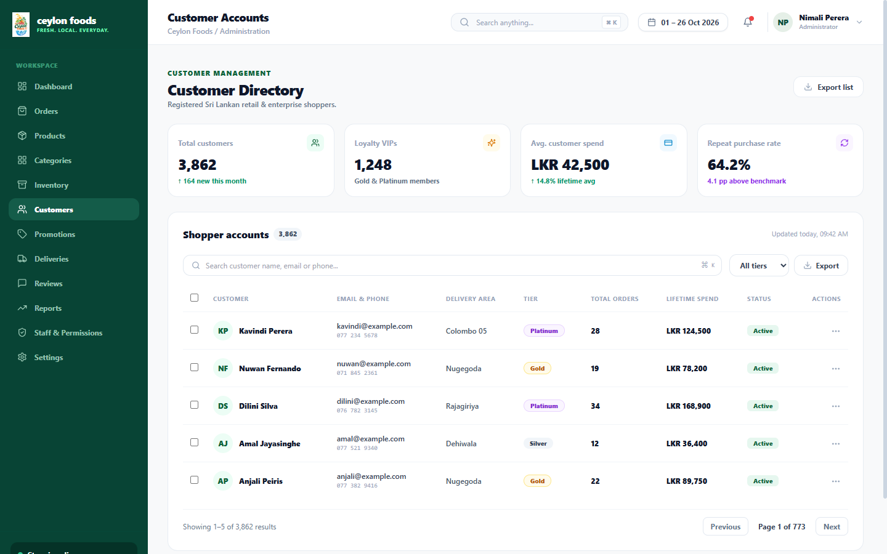

---

## 🌟 Key Features

### 📱 1. Customer Shopping Web App (`@supermarket/client` — Port `3000`)
- **Cultural Branding & Identity:** Authentic Ceylon Foods island emblem with tea plantations, coconut palms, dagoba silhouette, ocean waves, and harvest basket.
- **Sri Lankan Rupee (`Rs.` / `LKR`) Pricing:** Real-world supermarket pricing across all aisles matching leading Sri Lankan supermarket chains (Cargills, Keells, SPAR Sri Lanka, Arpico).
- **Splash Screen & 4-Step Cultural Onboarding Walkthrough:**
  - *"Ayubowan! සාදරයෙන් පිළිගනිමු — Sri Lanka Online Supermarket"*
  - Farm-fresh guarantee from Dambulla, Nuwara Eliya & Ambewela
  - Smart AI recipes with 1-tap cart bundling
  - Real-time live GPS courier tracking across Colombo zones
  - Dietary preferences & **Rs. 500 OFF** welcome coupon (`AYUBOWAN`)
- **Full Supermarket Catalog Across 8 Aisles:**
  - Fruits & Vegetables (Dambulla red onions, Nuwara Eliya leeks & carrots, Thambili king coconut, Gotukola)
  - Dairy & Eggs (Highland fresh milk, Ambewela curd, Kotmale cheddar, Bairaha farm eggs)
  - Bakery (Woodfired crispy roast paan, fresh pol roti, fish patties, croissants)
  - Meat & Fresh Seafood (Mirissa Yellowfin Tuna Kelawalla, Negombo lagoon prawns, Bairaha chicken breast)
  - Staples & Grains (Araliya Keeri Samba 5kg, Rathu Kakulu red raw rice, Mysore red dhal, virgin coconut oil, pure Ceylon cinnamon)
  - Beverages (Dilmah Ceylon BOPF tea, Elephant House Ginger Beer EGB, Nestlé Milo)
  - Snacks & Delicacies (Pure Kithul treacle, Munchee Super Cream Crackers, Maliban Lemon Puffs, jumbo cashews)
  - Household & Cleaning (Sunlight lemon dishwash, Dettol antiseptic)
- **Customer Feature Upgrades (Synced with Admin Engine):**
  - **Live Promo Code Validation Engine:** Validates active admin campaigns (`FRESH10` for 10% discount, `FREESHIP` for zero delivery fee, `AYUBOWAN` for Rs. 500 flat discount, `NOV500`) with instant savings calculation and applied coupon badges.
  - **Colombo Delivery Zone Logistics:** Real-time zone selection covering:
    - *Colombo Central (Colombo 01–07):* Rs. 300
    - *Colombo South (Colombo 08–15, Dehiwala):* Rs. 300
    - *Greater Colombo (Nugegoda, Rajagiriya, Battaramulla):* Rs. 350
    - *Outer Suburbs (Maharagama, Pannipitiya, Kottawa):* Rs. 450
  - **Automated Free Delivery Threshold:** Automatically waives delivery fees on all orders over **Rs. 5,000**, with a visual meter showing remaining amount to qualify.
  - **Tax Transparency:** VAT configured as inclusive in shelf prices, ensuring customers pay the exact transparent total displayed.
- **AI Culinary Concierge ("CeylonBot"):** Curates authentic Sri Lankan recipes (Ceylon Black Pepper Chicken Curry & Keeri Samba, Traditional Parippu & Pol Sambol with Roast Paan) with 1-click cart bundling.
- **Portion Weight Selector:** Custom weights for fresh produce (`250g`, `500g`, `1kg`, `2kg`).
- **Colombo Delivery Slots & Payment Methods:**
  - 45-Min Colombo Express, Today Afternoon, Evening, Night, Tomorrow Free Delivery
  - LankaQR / Online Cards (Visa/Mastercard/Amex), Card on Delivery (mPOS), Cash on Delivery (LKR)
- **Dual-Theme Support:** Clean Coconut-White Light Mode and OLED Dark Mode (`#0D0D0D`).

---

### 🖥️ 2. Admin & Operations Cockpit (`@supermarket/admin` — Port `3001`)
- **Strict Security Gate:** Complete isolation from customer web views. Protected by an administrative authentication barrier (`admin@ceylonfoods.lk` / `admin123`).
- **12 Interactive Operations Modules:**
  1. **Dashboard:** Daily sales metrics (LKR 8.46M), donut order status breakdown, revenue trends, and quick dispatch triggers.
  2. **Order Management:** Fulfillment pipeline (Pending, Confirmed, Picking, Dispatched, Delivered, Cancelled) with customer addresses, phone numbers, and timeline steppers.
  3. **Products Catalog:** Real-time search, category filtering, stock badges, price editing, and full product creation.
  4. **Categories Cockpit:** Visual photographic supermarket aisles, product counts, and display ordering.
  5. **Warehouse Inventory:** Live stock tracking with low-stock alerts and instant **+25**, **+50**, and **+100** 1-click restock actions.
  6. **Last-Mile Deliveries:** Daily delivery volume (86 today), awaiting assignment queue, active riders on the road (`Kasun Madushanka`, `Dinesh Kumara`, `Pradeep Silva`), and interactive `+ Assign delivery` modal.
  7. **Promotions & Campaigns:** Active voucher register (`FRESH10`, `FREESHIP`, `NOV500`), redemption counters, campaign rules toggles, and `+ Create promotion` modal.
  8. **Business Intelligence Reports:** Net sales, average order value (`LKR 6,591.00`), returning customer retention (64.2%), daily revenue spline charts, and category performance breakdown.
  9. **Staff & Permissions:** 12-member administrative directory, role-based access control (Super Admin, Store Manager, Delivery Lead, Inventory Lead), 2FA enforcement, and `+ Invite staff` modal.
  10. **Store Settings:** Regional preferences (LKR currency, 08:00 AM - 08:00 PM operating hours), payment gateways (PayHere, LankaQR, Cards, COD), 18% VAT configuration, delivery thresholds (Min order LKR 1,000 / Free delivery over LKR 5,000), and 4 Colombo delivery zones table.
  11. **Customer Reviews:** 4.9 average rating cockpit, rating distribution bars, verified buyer badges, and review moderation.
  12. **Customer CRM Directory:** Customer registry with lifetime spend in LKR, order counts, loyalty tier badges (Platinum, Gold, Silver, Bronze), and account status toggles.

---

### ⚙️ 3. Backend REST API (`@supermarket/server` — Port `5000`)
- Express + TypeScript REST API.
- Customer authentication & registration endpoints.
- Admin authentication gateway (`admin@ceylonfoods.lk`).
- Product CRUD & warehouse inventory restock endpoints.
- Order placement, delivery status stepper, and rider assignment.
- Promotions management and CeylonBot AI culinary assistant service.

---

## 🏗️ Project Architecture

```
smart_grocery_shopping_app/
├── client/              # Customer Web Store (React + Vite + Tailwind)
│   ├── public/
│   │   └── ceylon_foods_logo.png
│   ├── src/
│   │   ├── App.tsx      # Customer experience, promo engine & zone picker
│   │   └── main.tsx
│   └── package.json
├── admin/               # Operations Cockpit (React + Vite + Tailwind)
│   ├── public/
│   │   └── ceylon_foods_logo.png
│   ├── src/
│   │   ├── App.tsx      # 12 active admin modules & interactive modals
│   │   └── main.tsx
│   └── package.json
├── server/              # Backend REST API (Node.js + Express + TypeScript)
│   ├── src/
│   │   ├── index.ts     # Express routes and controllers
│   │   └── mockStore.ts # Sri Lankan supermarket catalog & mock dataset
│   └── package.json
├── shared/              # Shared TypeScript definitions & models
│   └── src/index.ts
├── screenshots/         # 17 live application preview screenshots
├── package.json         # Root npm workspaces runner
└── README.md
```

---

## 🚀 Quick Start Guide

### 1. Prerequisites
- [Node.js](https://nodejs.org/) (v18 or higher recommended)
- [npm](https://www.npmjs.com/) (v9 or higher)

### 2. Installation
Clone the repository and install all workspace dependencies from the root directory:
```bash
git clone https://github.com/d-navanith/smart_grocery_shopping_app.git
cd smart_grocery_shopping_app
npm install
```

### 3. Run Development Servers
Start client, admin, and backend concurrently with a single command:
```bash
npm run dev
```

| Service | Local URL | Default Credentials (if applicable) |
| :--- | :--- | :--- |
| **Customer Store** | `http://localhost:3000` | Register or login with `brie@example.com` / `password123` |
| **Admin Cockpit** | `http://localhost:3001` | `admin@ceylonfoods.lk` / `admin123` |
| **REST API Server** | `http://localhost:5000` | N/A |

---

## 🔐 Default Credentials

| Portal | URL | Email | Password |
| :--- | :--- | :--- | :--- |
| **Admin Cockpit** | `http://localhost:3001` | `admin@ceylonfoods.lk` | `admin123` |
| **Customer Store (Demo)** | `http://localhost:3000` | `brie@example.com` | `password123` |

*(Customers can also create a new account via the Sign Up form at any time, which automatically launches the Sri Lankan cultural splash screen and onboarding walkthrough!)*

---

## 🎨 Cultural Design Tokens & Branding
- **Ceylon Tea Green:** `#0C6237` / `#08542E`
- **Tropical Saffron Orange:** `#FF6515` / `#F05A22`
- **Indian Ocean Azure:** `#0284C7`
- **Electric Mint Accent:** `#78F9B8`
- **Golden Sun:** `#F59E0B`
- **OLED Night:** `#0D0D0D`
- **Coconut Cream White:** `#F8FAF9`

---

## 📄 License
This project is open-source under the MIT License.
