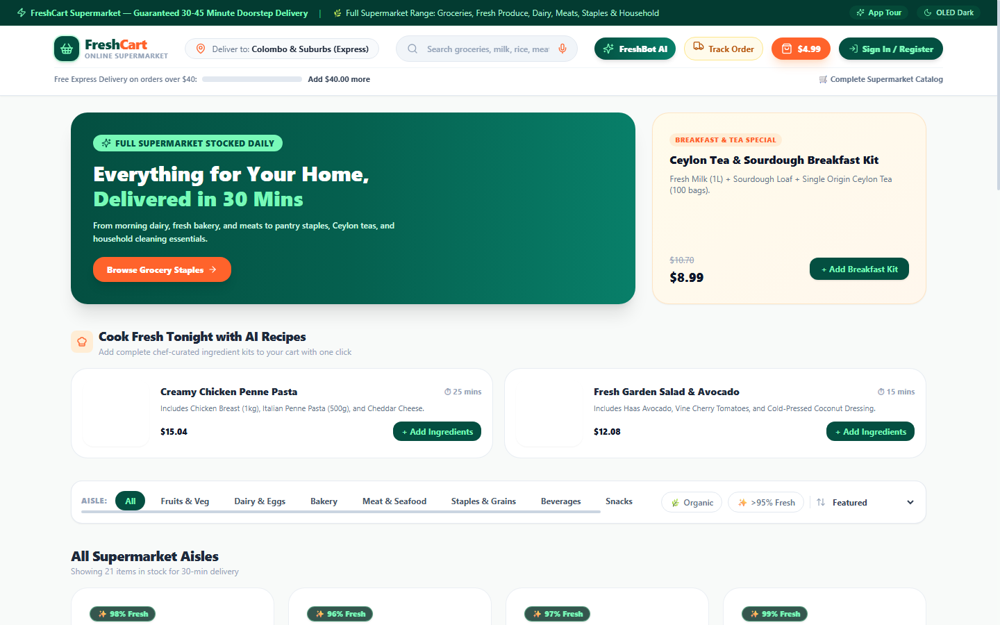
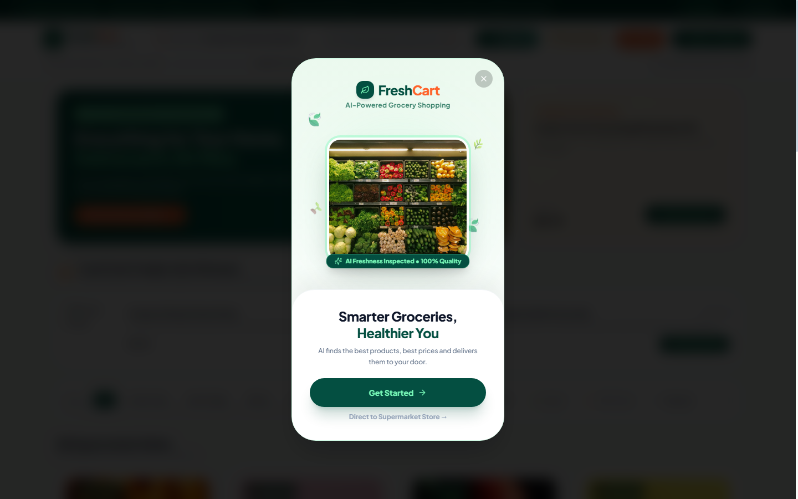
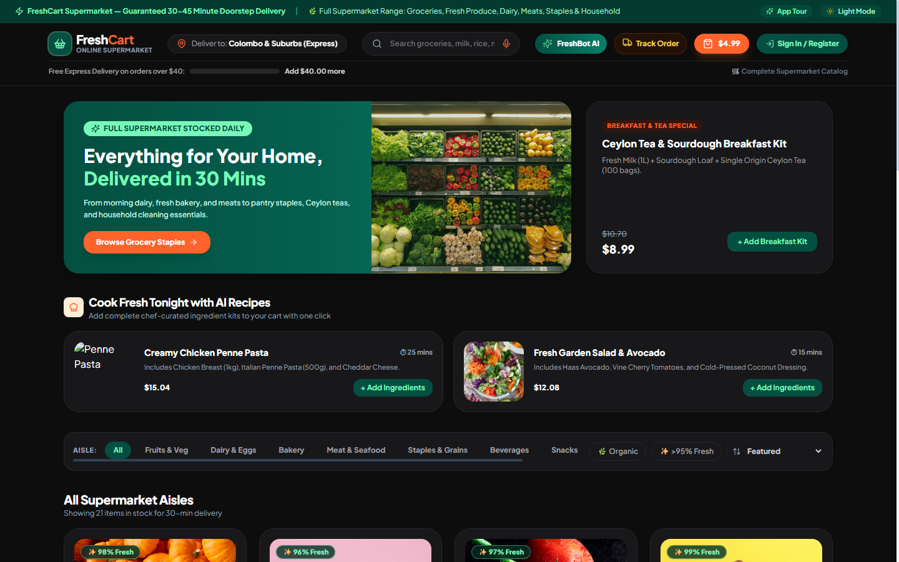
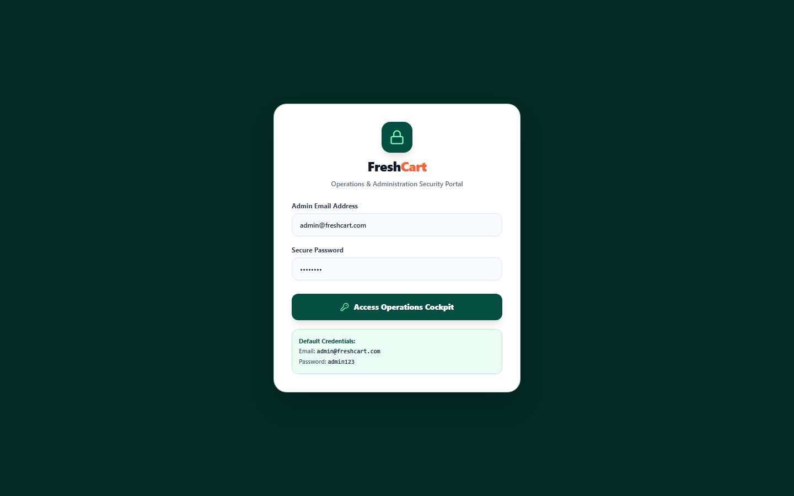
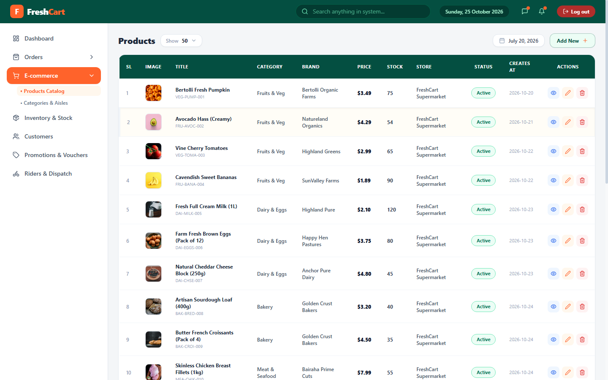
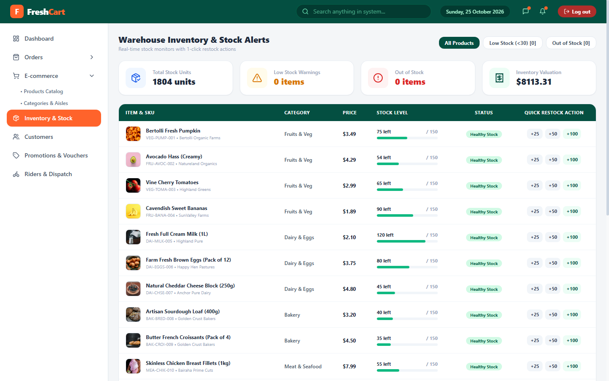

# 🛒 FreshCart — Smart Supermarket & Operations Platform

An AI-powered, omnichannel supermarket platform built with React, Vite, TypeScript, Tailwind CSS, Express, and modern monorepo workspaces.

Inspired by modern supermarket design systems and clean operations cockpits, this unified ecosystem provides a customer-facing e-commerce store alongside a secure, isolated operations portal.

---

## 📸 Screenshots & Visual Previews (Captured from Live System)

### 🛒 1. Customer Supermarket Storefront (Light Theme)


### ✨ 2. Figma-Inspired Splash & Onboarding Flow


### 🌙 3. Customer OLED Dark Mode


### 🔐 4. FreshCart Operations Authentication Portal


### 📊 5. FreshCart Products Cockpit (Full Supermarket Catalog)


### 📦 6. Warehouse Inventory & 1-Click Restock Actions


---

## 🌟 Key Features

### 📱 1. Customer Shopping Web App (`@supermarket/client` — Port `3000`)
- **Figma Splash Screen (Node `1-13587`):** 3D grocery basket with fresh produce, animated floating leaves, and *"Smarter Groceries, Healthier You"* branding.
- **4-Step Onboarding Walkthrough:**
  - Farm-fresh quality guarantee
  - Smart AI recipes & 1-tap cart bundling
  - Real-time live GPS courier tracking
  - Dietary preference selection & **$10 OFF** welcome coupon (`WELCOME10`)
- **Aisle Catalog Across 8 Supermarket Categories:**
  - Fruits & Vegetables, Dairy & Eggs, Bakery, Meat & Seafood, Staples & Grains, Beverages, Snacks, Household & Cleaning
- **AI Culinary Assistant ("FreshBot"):** Generates recipes (Salads, Soups, Dinners) and calculates nutritional macros.
- **Portion Weight Selector:** Choose weights for fresh produce (`250g`, `500g`, `1kg`, `2kg`).
- **Doorstep Delivery Slots & Substitution Preferences:** Select delivery windows, substitution policy (*Auto-Replace Best*, *Call Me First*, *Refund*), and payment methods.
- **Live GPS Tracking Modal:** Polyline route simulation with courier assignment and delivery ETA.
- **Dual-Theme Support:** Clean Light Mode and OLED Dark Mode (`#0D0D0D`).

---

### 🖥️ 2. Admin & Operations Cockpit (`@supermarket/admin` — Port `3001`)
- **Strict Security Gate:** Complete isolation from customer web views. Protected by an administrative authentication barrier (`admin@freshcart.com` / `admin123`).
- **Products Catalog Table:** Real-time search, "Show 50" dropdown selector, interactive Calendar popup, Add Product modal, View Details drawer, Edit Product form, and Delete actions.
- **Warehouse Inventory & Stock Alerts:** Real-time low-stock (<30 units) and out-of-stock monitor with instant **+25**, **+50**, and **+100** 1-click restock actions.
- **Customer Directory & Loyalty:** Shopper accounts, lifetime spend, order history, tier badges (Platinum, Gold, Silver, Bronze), and account suspend/activate toggles.
- **Promotions & Campaign Vouchers:** Manage discount vouchers (`FRESH20`, `FREEDELIVERY`, `ORGANIC15`), redemption limit meters, and campaign creation.
- **Courier Fleet & Live Dispatch:** Delivery rider roster with vehicle types, zone coverage, live ratings, and 1-click pending order assignment.
- **Operational Dashboard:** Weekly supermarket volume bar chart, KPI metric tiles, and recent orders stream.

---

### ⚙️ 3. Backend REST API (`@supermarket/server` — Port `5000`)
- Express + TypeScript REST API.
- Customer authentication & registration endpoints.
- Admin authentication gateway.
- Product CRUD & warehouse inventory restock endpoints.
- Order placement, delivery status stepper, and rider assignment.
- Promotions management and FreshBot AI assistant service.

---

## 🏗️ Project Architecture

```
smart_grocery_shopping_app/
├── client/              # Customer Web Store (React + Vite + Tailwind)
│   ├── src/
│   │   ├── App.tsx      # Full e-commerce customer experience & splash
│   │   └── main.tsx
│   └── package.json
├── admin/               # Operations Cockpit (React + Vite + Tailwind)
│   ├── src/
│   │   ├── App.tsx      # Admin dashboard, products, inventory, riders, vouchers
│   │   └── main.tsx
│   └── package.json
├── server/              # Backend REST API (Node.js + Express + TypeScript)
│   ├── src/
│   │   ├── index.ts     # Express routes and controllers
│   │   └── mockStore.ts # Comprehensive supermarket catalog & mock dataset
│   └── package.json
├── shared/              # Shared TypeScript definitions & models
│   └── src/index.ts
├── package.json         # Root npm workspaces runner
└── README.md
```

---

## 🚀 Quick Start Guide

### 1. Prerequisites
- [Node.js](https://nodejs.org/) (v18 or higher recommended)
- [npm](https://www.npmjs.com/) (v9 or higher)

### 2. Installation
Clone the repository and install all workspace dependencies from the root directory:
```bash
git clone https://github.com/YOUR_USERNAME/smart_grocery_shopping_app.git
cd smart_grocery_shopping_app
npm install
```

### 3. Run Development Servers
Start all 3 services concurrently with a single command:
```bash
npm run dev
```

The system will start on the following ports:
- **Customer Store:** [http://localhost:3000](http://localhost:3000)
- **Admin Cockpit:** [http://localhost:3001](http://localhost:3001)
- **Backend API:** [http://localhost:5000](http://localhost:5000)

---

## 🔐 Default Credentials

| Portal | URL | Email | Password |
| :--- | :--- | :--- | :--- |
| **Admin Cockpit** | `http://localhost:3001` | `admin@freshcart.com` | `admin123` |
| **Customer Store (Demo)** | `http://localhost:3000` | `brie@example.com` | `password123` |

*(Customers can also create a new account via the Sign Up form at any time, which automatically launches the Figma splash screen and onboarding walkthrough!)*

---

## 🎨 Design Tokens & Branding
- **Emerald Forest:** `#044F41`
- **Electric Mint:** `#78F9B8`
- **Vibrant Orange:** `#FF632B`
- **Charcoal:** `#2F2F2F`
- **OLED Black:** `#0D0D0D`
- **Off-White:** `#F8FAF9`

---

## 📄 License
This project is open-source under the MIT License.
